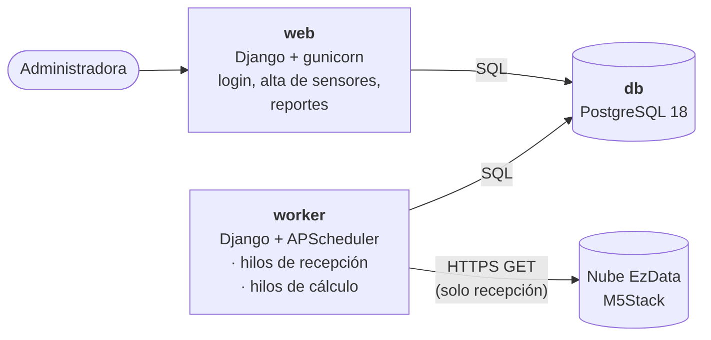

# Traviesos.py · SARRCA

SARRCA es el sistema que estamos haciendo para la red de sensores de calidad del aire de Zacatecas y Guadalupe. La idea es que las lecturas de los sensores M5Stack lleguen solas, se guarden sin perder ni repetir ninguna, se calculen los promedios como dice la NOM-025 y salgan los reportes diario y mensual que hoy se hacen a mano en Excel.

Equipo 3 · Administración de Proyectos de Software · Ago–Dic 2026 · UAZ

---

## Qué lleva el MVP

Para la primera entrega el flujo es más o menos este: la administradora entra, registra un sensor, las lecturas empiezan a llegar solas y cada día puede ver su reporte diario (gráficas de cada variable + tabla de promedios de 24 h). Al cerrar el mes ve el reporte mensual.

O sea, en el MVP van:

- Inicio de sesión
- Registrar un sensor
- Recibir las lecturas automáticamente desde la nube de M5Stack (EzData)
- Saber si cada hora es válida y calcular su concentración
- Promedio diario y excedencias de la norma
- Reporte diario y reporte mensual

Lo que **no** va todavía (ni el código ni sus tablas): bitácora, monitoreo de salud del sistema, respaldos, correos, banderas automáticas, catalogar lecturas, el índice de calidad del aire, PDF, borrado de datos personales e invitaciones. Todo eso llega en los incrementos.

---

## Tecnologías

| Para qué | Qué usamos |
|---|---|
| Lenguaje / framework | Python 3.13 y Django 5.2 LTS |
| Interfaz | Plantillas de Django + HTMX 2 + Bootstrap 5 (todo se genera en el servidor, no hay React ni nada así) |
| Gráficas | Chart.js 4.5.1, servido desde `static/vendor/` |
| Base de datos | PostgreSQL 18 |
| Tareas en segundo plano | APScheduler, en un contenedor aparte (`worker`) |
| Cifrado | `cryptography` (Fernet) |
| Contenedores | Docker Compose |
| Calidad | pytest y ruff, que cada quien corre antes de abrir su PR (la integración continua llega después) |

---

## Cómo está armado

Es un **monolito modular**: un solo proyecto de Django partido en módulos (apps), y el mismo código corre en dos procesos.



### Los procesos

- **web**: las pantallas, los permisos por rol, el alta de sensores y los reportes. La web **nunca** le habla a EzData; cuando das de alta un sensor solo deja una "verificación pendiente" en la base y el worker se encarga.
- **worker**: un solo proceso con dos grupos de hilos, para que uno no frene al otro.
  - *Recepción*: consulta la nube cada 15 min, baja el historial una vez al día (02:10), concilia los domingos y atiende las verificaciones de los sensores nuevos.
  - *Cálculo*: cada minuto revisa qué horas hay que recalcular, y cierra la hora (a las hh+1:20), el día (00:30) y el mes (el día 1 a las 00:45).
- **db**: los datos, y además es por donde se coordinan web y worker.

No usamos broker (ni Celery, ni Redis, ni señales de Django). Web y worker se comunican con tablas: la web crea una *verificación de sensor* y la va consultando cada 2 s con HTMX hasta que el worker deja el resultado; y cada vez que se guarda una lectura se deja una *marca de recálculo* que el cálculo recoge después.

### Capas dentro de cada módulo

Siempre se llama hacia abajo, nunca al revés:

| Capa | Archivo(s) | Qué va ahí |
|---|---|---|
| Presentación | `views.py`, `urls.py`, `forms.py`, `templates/` | Nada de reglas de negocio, solo llama a servicios y consultas |
| Servicios | `services.py` | Lo único que escribe en la base. Revisa el rol y abre la transacción |
| Consultas | `selectors.py` | Lo que leen las pantallas y los reportes |
| Modelos | `models.py` | Las tablas |
| Tareas | `jobs.py` | Las tareas programadas; llaman a los mismos servicios que la web |

Hay dos excepciones a propósito:

- **`calculo/dominio/`** es Python puro, **sin Django y sin base de datos**. Ahí van las reglas de la norma (hora válida, concentración horaria, promedio de 24 h, excedencias, promedio mensual). Así se pueden probar solitas contra el cálculo a mano.
- **`recepcion/ports.py` + `recepcion/adapters/`**: EzData no tiene documentación y puede cambiar cuando quiera, entonces el resto del sistema habla con una interfaz (`FuenteDeLecturas`) y solo `adapters/ezdata.py` sabe cómo responde la nube. Para pruebas hay otra fuente que lee de un archivo.

En cada PR se revisa a mano que:

1. ningún módulo importe `reportes`,
2. solo `recepcion.adapters` sepa de EzData,
3. `calculo.dominio` no importe Django.

(Después lo revisará solo import-linter, cuando haya integración continua.)

### Cosas que hay que respetar sí o sí

- **Hora local de Zacatecas en todo**: `USE_TZ=False` y `TIME_ZONE="America/Mexico_City"`, igual en los contenedores y en APScheduler. EzData manda la hora en UTC+8; se convierte en el adaptador y en ningún otro lado.
- **MAC y token de los sensores van cifrados** (y la MAC con una huella HMAC para poder buscarla). Nunca deben salir en logs ni en mensajes de error.
- **Las lecturas solo se insertan**, no se editan ni se borran. Todas entran por `lecturas.services.registrar_lectura`, que evita duplicados con la clave (sensor, hora de la nube, huella).
- Se guarda el dato crudo tal cual llega (el campo `value`), pero **sin el token**.
- Un valor que no vino es `None`, **no** `0`.
- Se redondea solo al final: un decimal en la hora y en el día.
- Se calculan PM2.5 y PM10, y con la misma regla PM1, PM4 y CO2. Temperatura, humedad, VOC y NOx no se calculan.
- Los límites de la norma no se ponen como constantes en el código: están en una tabla con fechas de vigencia y se usa el que aplicaba en la fecha del dato.

---

## Estructura de carpetas

Las apps están en `src/` y esa carpeta se agrega al `PYTHONPATH` (en `manage.py`, en `worker/main.py`, en la config de pytest y en el Dockerfile). Por eso se importan directo, `from recepcion.ports import FuenteDeLecturas`, y **no** `from src.recepcion...`.

Lo marcado con *(después)* todavía no existe, se crea cuando toque.

```
Traviesos.py/
├── docker-compose.yml           # web, worker y db
├── Dockerfile                   # una sola imagen para web y worker
├── .env.example                 # nombres de las variables, sin valores
├── requirements.txt
├── pyproject.toml               # ruff y pytest (pythonpath = ["src"])
├── manage.py
├── .github/workflows/ci.yml     # (después) pruebas y ruff en cada PR
│
├── config/                      # settings.py, urls.py, wsgi.py
│
├── src/
│   ├── cuentas/                 # usuarios y roles, login, bloqueo por intentos, permisos,
│   │                            #   comandos crear_admin y precargar_cuentas
│   ├── sensores/                # sensores, ubicación y responsable, colonias, cifrado, alta con HTMX
│   │   └── fixtures/            # catálogo de colonias
│   ├── recepcion/               # tareas de consulta a la nube
│   │   ├── ports.py             # FuenteDeLecturas, LecturaNormalizada, FuenteNoDisponible
│   │   ├── adapters/            # ezdata.py, el único que habla con la nube
│   │   └── tests/fixtures/      # respuestas guardadas de EzData (sin MAC ni token!)
│   ├── lecturas/                # Lectura, registrar_lectura, interpretación del valor que llega
│   ├── calculo/
│   │   └── dominio/             # la norma en Python puro: tipos, cobertura, horario, diario, mensual, redondeo
│   ├── reportes/                # series para las gráficas, láminas del día, reportes diario y mensual
│   ├── operacion/               # por ahora vacío
│   ├── bitacora/                # (después)
│   └── notificaciones/          # (después) correos
│
├── worker/                      # main.py: arranca APScheduler con los dos grupos de hilos
├── templates/                   # base.html, menú, páginas de error
├── static/                      # vendor/ (Bootstrap, HTMX, Chart.js), css/, js/
├── scripts/                     # (después) respaldo y restauración
└── tests/
    ├── datos/                   # datos de prueba compartidos (lecturas reales de un sensor + casos de borde)
    └── integracion/             # pruebas de punta a punta
```

Dentro de cada app, cuando se cree, va lo de la tabla de capas: `models.py`, `services.py`, `selectors.py`, `views.py`, `urls.py`, `forms.py`, `jobs.py`, `templates/<app>/`, `management/commands/` y `tests/`.

> Cada app ya tiene su `__init__.py` y su `apps.py` con `name = "cuentas"` (sin el `src.`). Si algún archivo dice *Provisional* arriba, es un lugar apartado: lo reemplaza completo quien programa esa parte.

### ¿Dónde pongo lo que voy a programar?

| Si es… | Va en… |
|---|---|
| Una regla de la norma (hora válida, promedio, excedencia…) | `src/calculo/dominio/`, en Python puro y con su prueba |
| Algo que escribe en la base | el `services.py` del módulo |
| Una consulta para una pantalla o reporte | el `selectors.py` del módulo |
| Algo que sabe cómo responde EzData | `src/recepcion/adapters/ezdata.py` y nada más |
| Una tarea programada | el `jobs.py` del módulo, y se registra en `worker/main.py` |
| Gráficas / series de datos | `src/reportes/` |
| Datos de prueba | `tests/datos/` (porfa no dejen datos de prueba sueltos por ahí) |

Si no saben en qué módulo va algo, pregunten antes de crear el archivo.

---

## Git

1. Antes de empezar: `git pull origin develop`.
2. Cada quien trabaja en su rama, que sale de `develop`. Nada directo a `main`.
3. Commits tipo *Conventional Commits*: `feat(recepcion): adaptador de EzData`, `fix(calculo): ...`, etc.
4. PR hacia `develop`, mínimo una vez al día, y lo revisa alguien que no lo programó.

---

## Instalación

Necesitas Docker Desktop (o Docker con Compose) y, para correr las pruebas desde tu máquina, Python 3.12 o más nuevo. Los comandos son para PowerShell; en Linux o Mac cambia `copy` por `cp`.

1. **El `.env`.** Copia el ejemplo y llénalo:

   ```bash
   copy .env.example .env
   ```

   Llena `DJANGO_SECRET_KEY` (cualquier texto largo y secreto), `SARRCA_DB_CONTRASENA` (la contraseña que tendrá la base) y `SARRCA_CLAVE_SECRETOS`, que se genera así:

   ```bash
   python -c "from cryptography.fernet import Fernet; print(Fernet.generate_key().decode())"
   ```

   `SARRCA_FUENTE` dice de dónde lee el worker las lecturas: `ezdata` es la nube de M5Stack y `archivo` es una muestra guardada de un sensor real, para probar sin depender de que un sensor transmita.
   Con `archivo`, pon también en `SARRCA_FUENTE_ARCHIVO_FIN` la fecha y hora de hoy (por ejemplo, `2026-10-16T09:00`): la muestra se acomoda para terminar ahí y, aunque reinicies el worker, cae siempre en las mismas horas.

2. **Levantar la base y la web** (la primera vez tarda unos minutos):

   ```bash
   docker compose up -d --build db web
   ```

3. **Preparar la base**, en este orden:

   ```bash
   docker compose exec web python manage.py migrate
   docker compose exec web python manage.py loaddata colonias
   docker compose exec web python manage.py crear_admin --correo tu-correo@ejemplo.mx --nombre "Tu nombre"
   ```

   - `migrate` crea las tablas y carga los límites de la NOM-025.
   - `loaddata colonias` carga el catálogo de colonias de Zacatecas y Guadalupe. Sin él no se puede registrar ningún sensor.
   - `crear_admin` crea la cuenta de la Administradora y te pide su contraseña dos veces (mínimo 8 caracteres).

4. **Las cuentas de los vecinos responsables.** Se cargan desde un CSV con las columnas `correo,nombre,municipio,colonia`. El de verdad lleva datos personales y nunca se sube al repositorio; para probar está `tests/datos/precarga_cuentas_ejemplo.csv`. La contraseña inicial de esas cuentas sale de `SARRCA_PRECARGA_CONTRASENA` (sin ella, las cuentas se crean pero no pueden entrar):

   ```bash
   docker compose exec -e SARRCA_PRECARGA_CONTRASENA=una-contraseña-de-prueba web python manage.py precargar_cuentas tests/datos/precarga_cuentas_ejemplo.csv
   ```

5. **Arrancar el proceso de fondo**, ya con la base lista:

   ```bash
   docker compose up -d worker
   docker compose logs worker
   ```

   Debe decir «Worker iniciado con 9 tareas».

6. **Listo.** La web queda en http://127.0.0.1:8000/. Entra con la cuenta de Administradora, registra un sensor en **Sensores** y en unos segundos aparece el resumen para confirmarlo. Con `docker compose logs -f worker` ves qué está haciendo el proceso de fondo.

Si cambias `SARRCA_FUENTE` en el `.env`, reinicia el worker: `docker compose up -d worker`.

### Pruebas

La base corre en Docker y las pruebas desde tu máquina (el `.env` ya apunta a `127.0.0.1`):

```bash
python -m venv .venv
.venv\Scripts\activate         # en Linux o Mac: source .venv/bin/activate
pip install -r requirements.txt
docker compose up -d db
pytest
ruff check .
```

Si el puerto 5432 de tu máquina ya está ocupado (por ejemplo, porque tienes otro PostgreSQL), pon otro en `SARRCA_DB_PUERTO` del `.env`, como `55432`, y vuelve a levantar la base.
